# Woltish - Food Delivery Web Application

## Overview
Woltish is a full-stack food delivery web application inspired by Wolt. Users can browse restaurants, search for dishes, and place orders. The system supports two roles — customers and restaurant owners — each with a tailored experience.

The backend is a Node.js/Express REST API using JWT authentication and MongoDB (via Mongoose) for persistent storage. The frontend is built with React, featuring real-time search, a shopping cart, order history, restaurant management, and dark/light mode.

---

## System Architecture

```text
SYSTEMS-PROGRAMMING/
│
├── client/                       # Python Client (Assignment 2)
├── data/                         # Persistent data for C++ Server
├── src/                          # C++ Server Source Files
├── tests/                        # C++ Unit Tests (Google Test)
├── CMakeLists.txt                # C++ Build Configuration
├── Dockerfile.server             # C++ Server Docker image
├── Dockerfile.client             # Python Client Docker image
├── docker-compose.yml            # Full system orchestration
│
├── restaurants-web-server/       # Node.js/Express API Server
│   ├── src/
│   │   ├── controllers/          # Request handlers
│   │   ├── models/               # Mongoose schemas (MongoDB)
│   │   ├── routes/               # Express route definitions
│   │   ├── middlewares/          # Auth middleware (JWT)
│   │   └── utils/                # TCP client, seed data
│   ├── uploads/                  # User profile images
│   ├── Dockerfile
│   └── package.json
│
├── restaurants-web-client/       # React Frontend
│   ├── src/
│   │   ├── components/           # React components
│   │   ├── data/                 # Static data files
│   │   └── assets/               # Static assets
│   ├── Dockerfile
│   └── package.json
│   
└── restaurants-mobile/           # React Native (Expo Router) mobile app
    ├── app/                      # Screens (file-based routing: login, register, tabs, restaurant/[id])
    ├── assets/                   # Images, fonts, icons
    ├── components/                # AuthContext, CartContext
    ├── constants/                 # API config (Config.js)
    └── package.json
```

---

## Running the System via Docker

### Prerequisites
- Docker Desktop installed and running
- Copy the environment file before starting:
```bash
  cp restaurants-web-server/.env.example restaurants-web-server/.env
```

### Start all services
```bash
docker-compose up --build
```

This builds and starts 5 services:
| Service | Description | Port |
|---|---|---|
| `mongo` | MongoDB database | 27017 |
| `server` | C++ TCP Recommender Server | 8080 |
| `web-server` | Node.js REST API | 5000 |
| `web-client` | React Frontend | 3000 |
| `client` | Python CLI Client | — |
| `tests` | C++ Test Runner | — |

### Start each backend piece individually

**Terminal 1 — MongoDB:**
```bash
docker-compose up --build mongo
```

**Terminal 2 — C++ Recommender Server + Node.js API:**
```bash
docker-compose up --build server web-server
```

**Terminal 3 — React Frontend:**
```bash
docker-compose up --build web-client
```

### Stop all services
```bash
docker-compose down
```

### Run C++ tests
```bash
docker-compose run tests
```

### Access the application
Open your browser at: **http://localhost:3000**

---

## Running the System without Docker

### Prerequisites
- Node.js 18+ installed
- npm installed
- MongoDB running locally (or via the single Docker container shown below)

### 1. Start MongoDB
```bash
docker run -d -p 27017:27017 mongo:7
```

### 2. Start the Node.js API server
```bash
cd restaurants-web-server
npm install
node src/server.js
```
The server will start on port 5000 and seed the default restaurants automatically.

### 3. Start the React client
Open a new terminal:
```bash
cd restaurants-web-client
npm install
npm start
```
The client will start on port 3000 and open automatically in your browser at **http://localhost:3000**.

## Running the Mobile App

The mobile app (React Native + Expo) runs separately from docker-compose.

### Prerequisites
- Node.js 18+
- Android Studio with an emulator configured, or a physical device with Expo Go
- The backend running (via docker-compose or manually) on port 5000

### Setup
```bash
cd restaurants-mobile
npm install
```

Edit `constants/Config.js` and set the API URL for your testing environment:
- **Web browser**: uses `localhost` automatically, no change needed
- **Android Emulator**: set to `http://10.0.2.2:5000`
- **iOS Simulator**: set to `http://localhost:5000`
- **Physical device**: set to your machine's local network IP (e.g. `http://192.168.x.x:5000`)

### Run
```bash
npm start
```
Press `a` to open on Android, or scan the QR code with Expo Go on a physical device.

---

## User Roles & Features

### 👤 Guest (not logged in)
- Browse all restaurants
- Attempting to place an order redirects to the login page

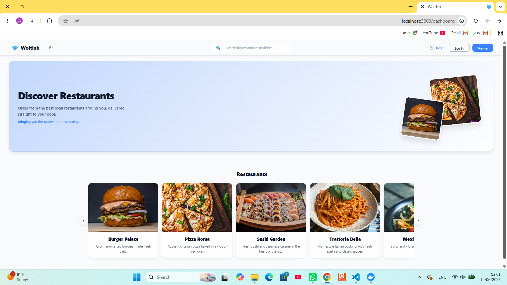

### 🛒 Customer
- Browse and search restaurants
- Add products to cart and place orders
- View personal order history

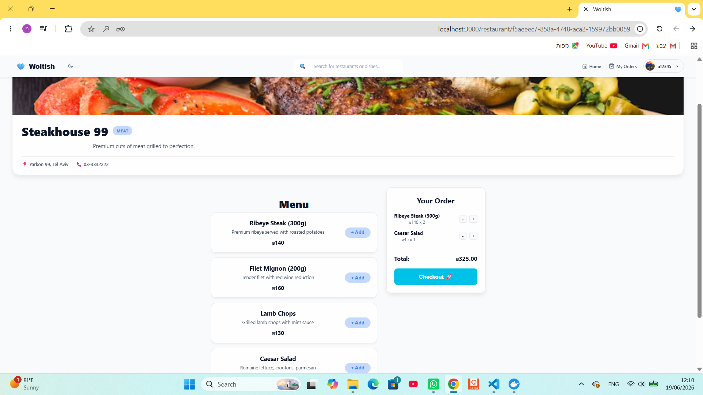

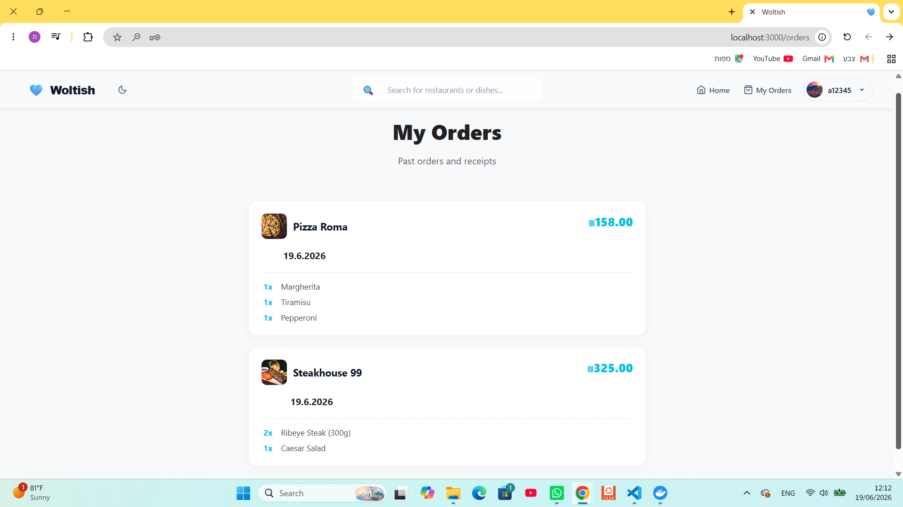

### 🏪 Restaurant Owner
- Browse restaurants (no cart or checkout)
- Create a new restaurant via a form
- After creation, redirected to a restaurant management page to add products
- View, edit, and delete their own restaurants in "My Restaurants" page
- Only the owner who created a restaurant can edit or delete it

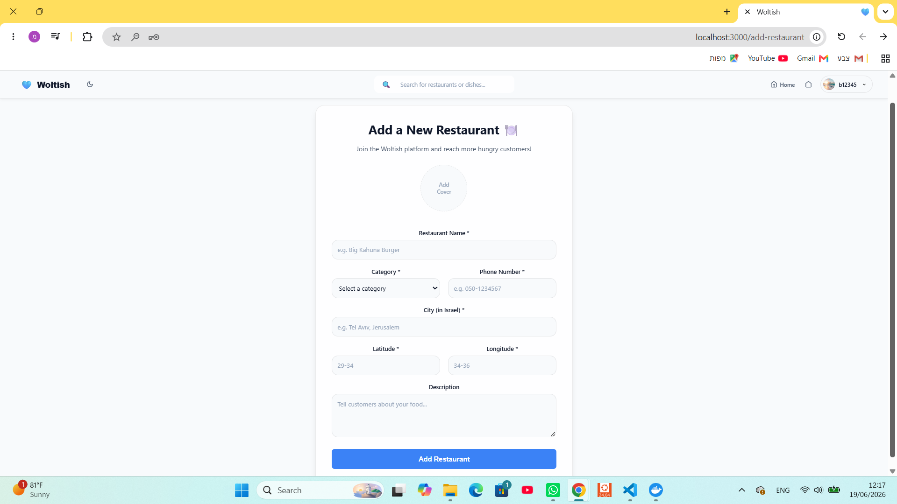

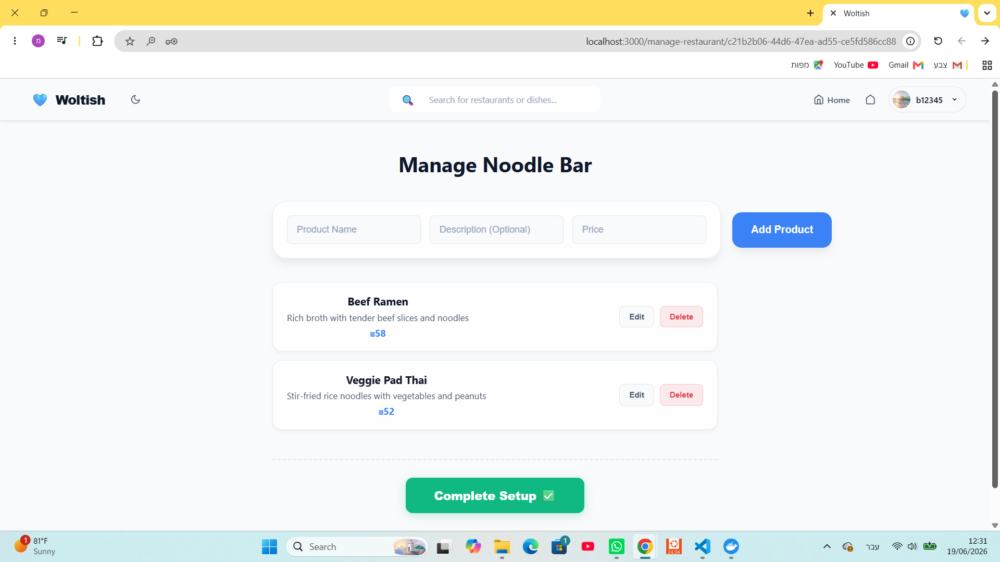

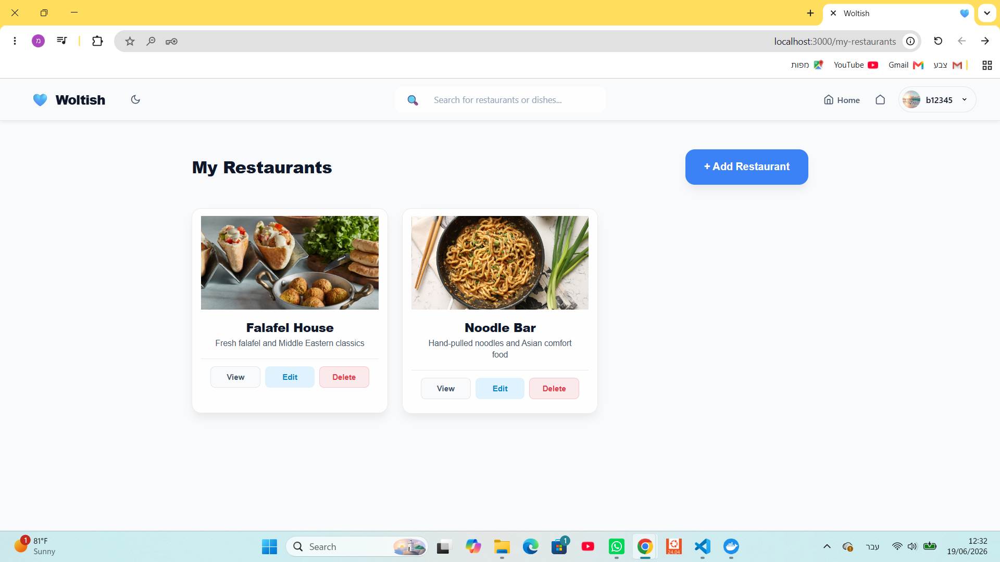

---

## Key Features

### 🔐 Authentication
- JWT-based login and registration
- Profile image upload on registration
- Role selection: Customer or Restaurant Owner

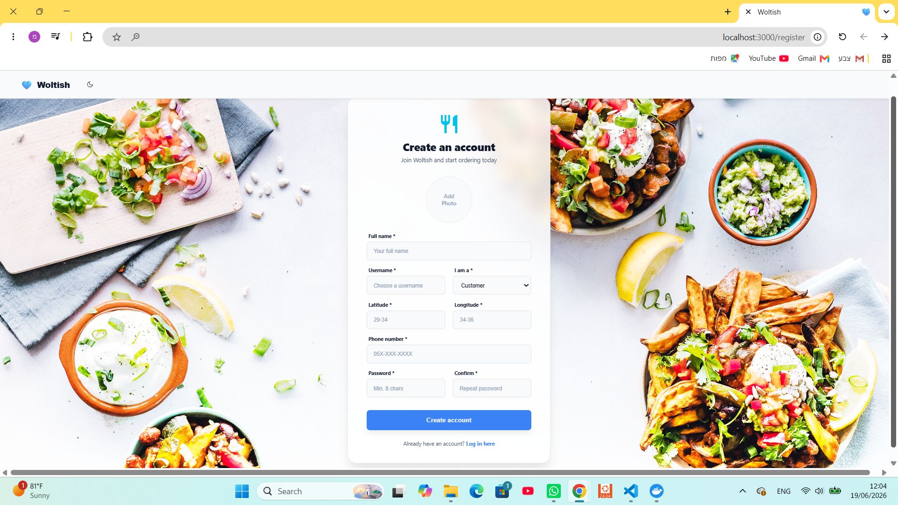

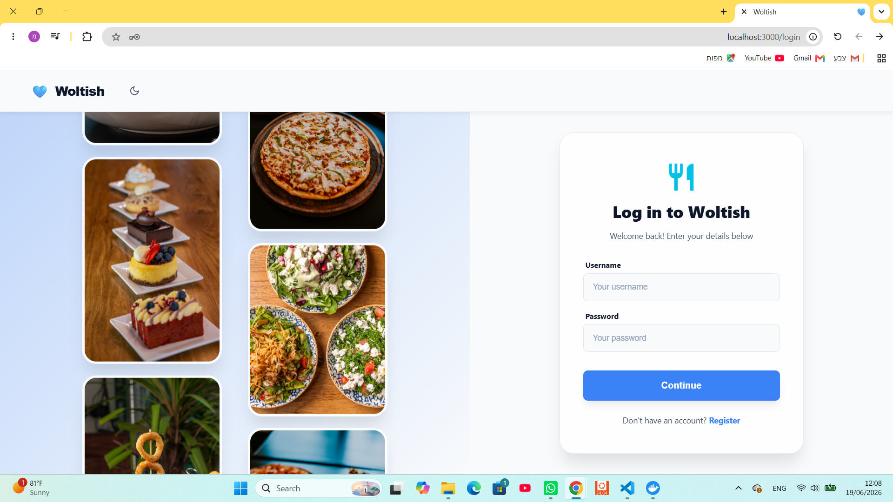

### 🔍 Search
- Real-time search across restaurant names, descriptions, and menu items
- Results show a hint indicating whether the match was on the name, description, or a dish

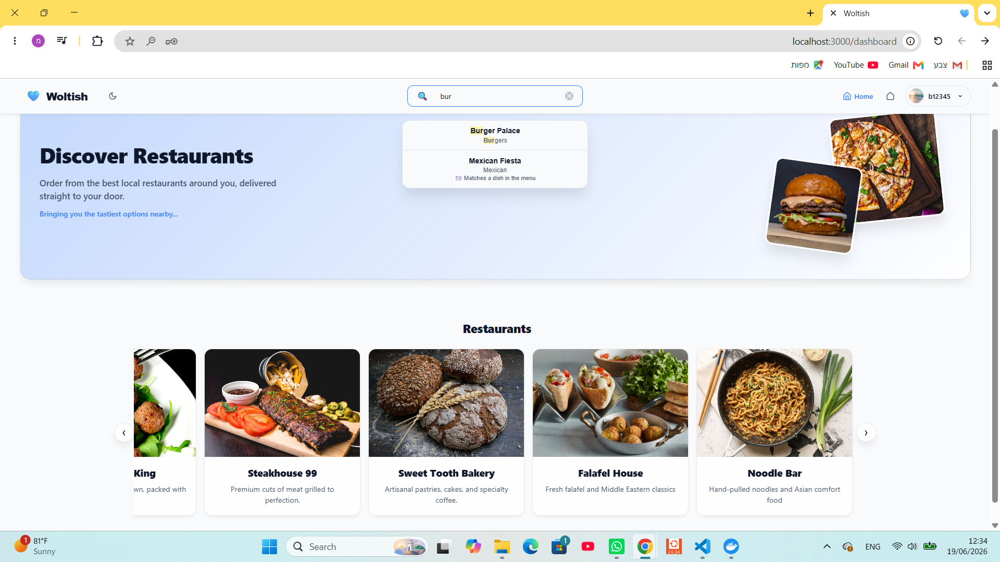

### 🌙 Dark / Light Mode
- Toggle between dark and light themes from the navbar

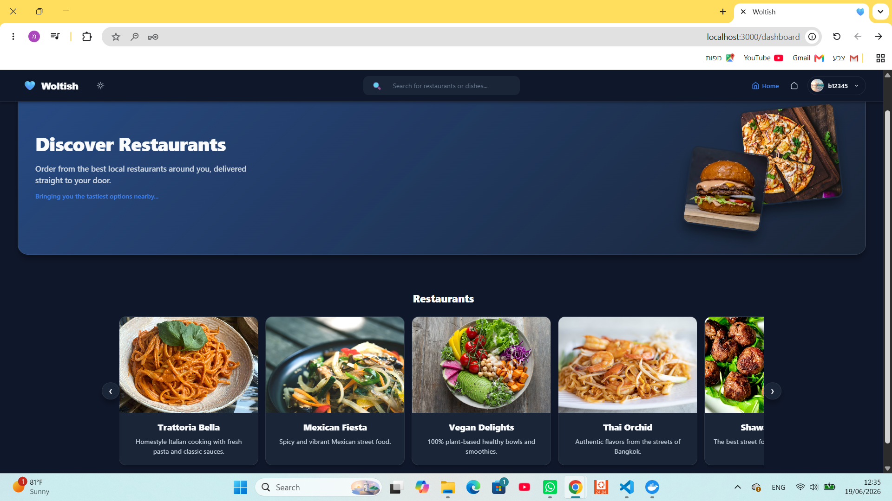

### 📍 Distance Sorting
- The dashboard shows a "Close to You" section with restaurants nearest to the address entered during registration
- All other restaurants are shown below in the main "Restaurants" carousel

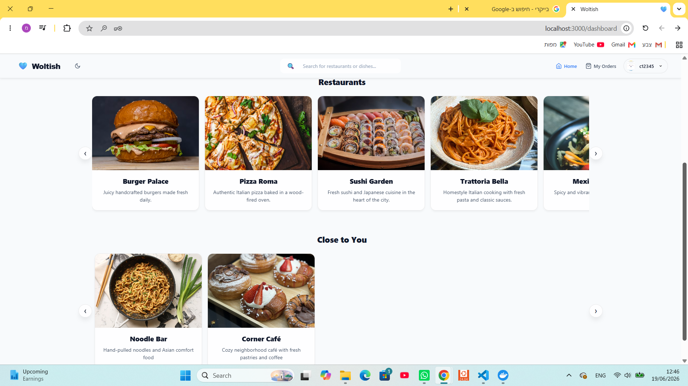

### 🍽️ Default Restaurants
- 10 default restaurants with full menus are seeded on server startup, spanning multiple cuisines:
  - Burger Palace (Burgers), Pizza Roma (Pizza), Sushi Garden (Sushi), Trattoria Bella (Italian), Mexican Fiesta (Mexican), Vegan Delights (Vegan), Thai Orchid (Thai), Shawarma King (Street Food), Steakhouse 99 (Meat), Sweet Tooth Bakery (Bakery)

---

## API Endpoints (Node.js Server — port 5000)

### Users
| Method | Endpoint | Description | Auth |
|---|---|---|---|
| POST | `/api/users` | Register a new user (multipart/form-data) | No |
| GET | `/api/users/:id` | Get user by ID | No |

### Tokens
| Method | Endpoint | Description | Auth |
|---|---|---|---|
| POST | `/api/tokens` | Login and receive JWT | No |

### Restaurants
| Method | Endpoint | Description | Auth |
|---|---|---|---|
| GET | `/api/restaurants` | Get all restaurants | No |
| GET | `/api/restaurants/my` | Get owner's restaurants | Required |
| GET | `/api/restaurants/:id` | Get restaurant by ID | No |
| POST | `/api/restaurants` | Create restaurant | Owner only |
| PATCH | `/api/restaurants/:id` | Update restaurant | Owner only |
| DELETE | `/api/restaurants/:id` | Delete restaurant | Owner only |

### Products
| Method | Endpoint | Description | Auth |
|---|---|---|---|
| GET | `/api/restaurants/:id/products` | Get all products | No |
| POST | `/api/restaurants/:id/products` | Add product | Required |
| GET | `/api/restaurants/:id/products/:pId` | Get product by ID | No |
| PATCH | `/api/restaurants/:id/products/:pId` | Update product | Required |
| DELETE | `/api/restaurants/:id/products/:pId` | Delete product | Required |

### Orders
| Method | Endpoint | Description | Auth |
|---|---|---|---|
| GET | `/api/orders` | Get user's orders | Required |
| POST | `/api/orders` | Place an order | Customer only |
| GET | `/api/orders/:id` | Get order by ID | Required |
| PATCH | `/api/orders/:id` | Update order | Required |
| DELETE | `/api/orders/:id` | Delete order | Required |

### Search
| Method | Endpoint | Description | Auth |
|---|---|---|---|
| GET | `/api/search/:query` | Search restaurants and products | No |