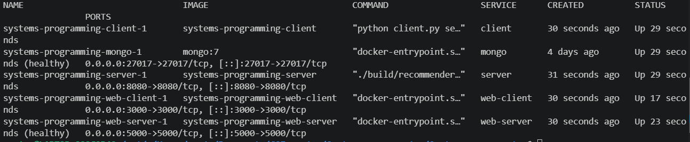
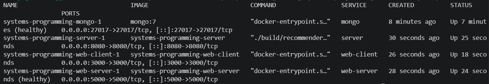
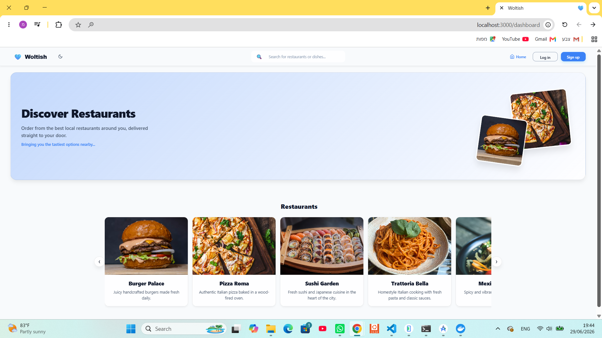
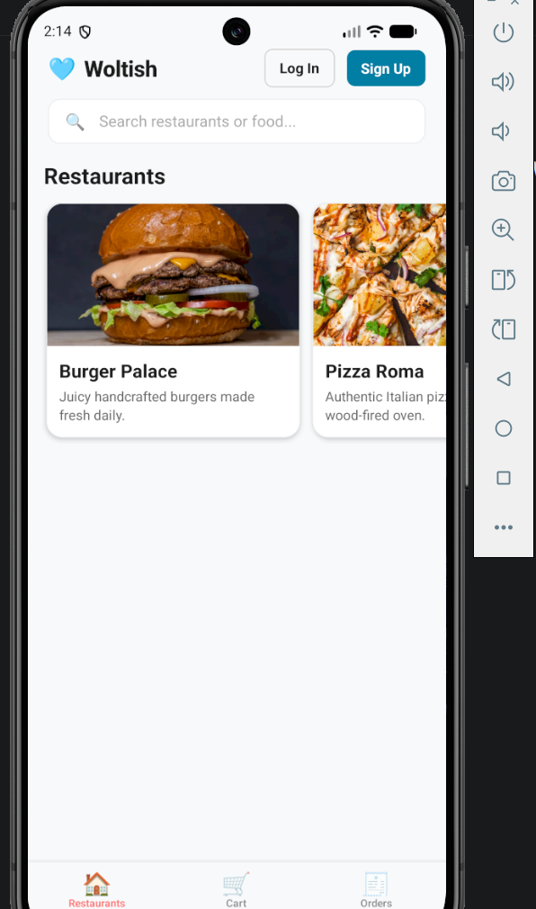

# Environment Setup

## Prerequisites
- Docker Desktop installed and running
- Node.js 18+ (for running the mobile app)
- Android Studio with an emulator configured (for mobile testing)

## Step 1: Clone the repository
```bash
git clone <repo-url>
cd Systems-programming
```

## Step 2: Configure environment variables
```bash
cp restaurants-web-server/.env.example restaurants-web-server/.env
```

For the mobile app, edit `restaurants-mobile/constants/Config.js` and set the API URL to match your testing environment (emulator, simulator, or physical device) — see comments in the file for exact values.

## Option A: Run everything together via Docker Compose

```bash
docker-compose up --build
```

Once all services are up, you can check their status from a second terminal:
```bash
docker-compose ps
```



Stop with:
```bash
docker-compose down
```

## Option B: Run server and client in separate Docker containers, in separate terminals

Each part of the system can also be started independently, from different terminals, while still using Docker for each piece.

**Terminal 1 — Backend (mongo + server + web-server):**
```bash
docker-compose up --build mongo server web-server
```

**Terminal 2 — Frontend (web-client):**
```bash
docker-compose up --build web-client
```

Check status from a third terminal:
```bash
docker-compose ps
```



## Option C: Run server and client manually, without Docker

**Terminal 1 — MongoDB:**
```bash
docker run -d -p 27017:27017 mongo:7
```

**Terminal 2 — Node.js API server:**
```bash
cd restaurants-web-server
npm install
node src/server.js
```

**Terminal 3 — React client:**
```bash
cd restaurants-web-client
npm install
npm start
```

## Open the web client
Navigate to **http://localhost:3000**.



## Run the mobile app
```bash
cd restaurants-mobile
npm install
npm start
```
Press `a` to launch on the Android emulator.

