# CRUD Operations: Restaurants, Dishes & Orders

Demonstrates create, edit, delete, and ordering — web and mobile.

## Test data

**Restaurant** (as `wikidemo_owner`):
- Name: Wiki Demo Gelato | Category: Ice Cream | Phone: 0501112222
- City: Tel Aviv | Lat: 32.08 / Lng: 34.78
- Description: A demo ice cream shop created for wiki documentation purposes.

**Dish:**
- Name: Pistachio Scoop | Price: 18
- Description: Creamy pistachio gelato, made fresh daily.

**Dish:**
- Name: Vanilla Scoop | Price: 18
- Description: Creamy vanilla gelato, made fresh daily.

---

## Web Client

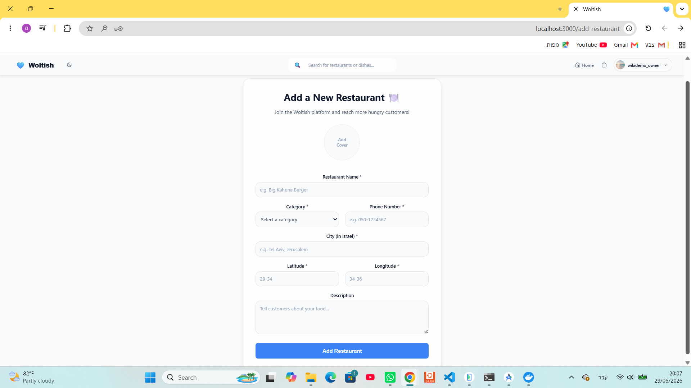

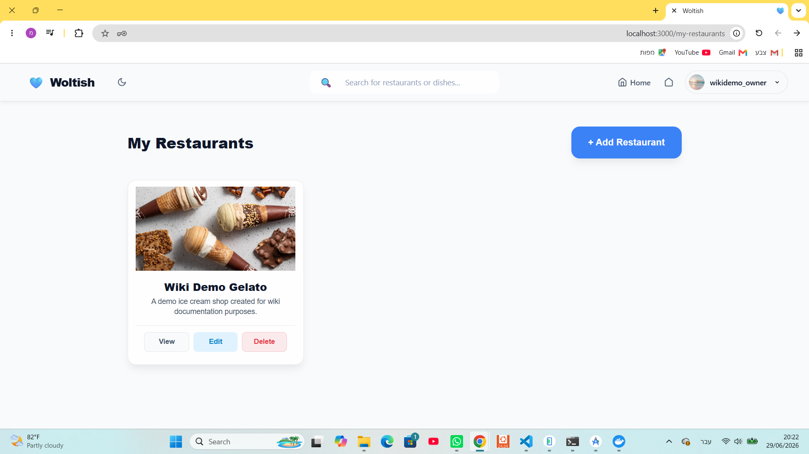

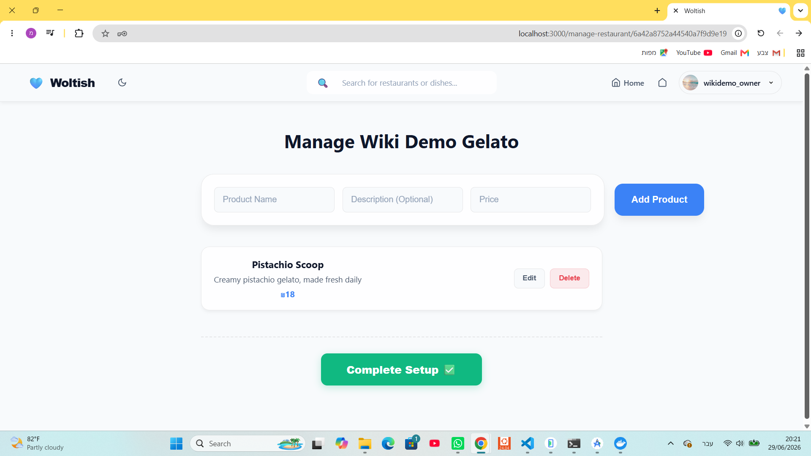

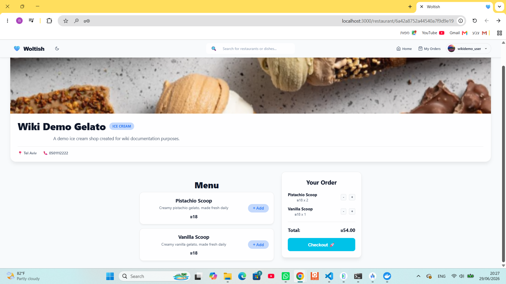

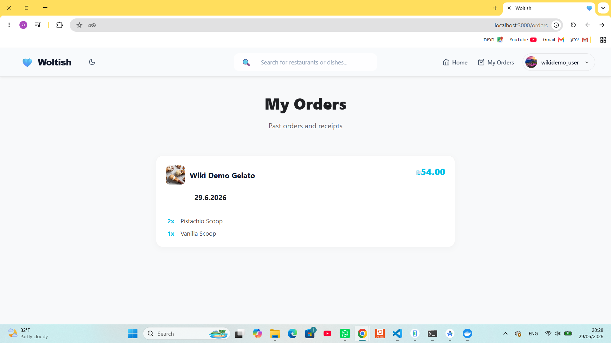

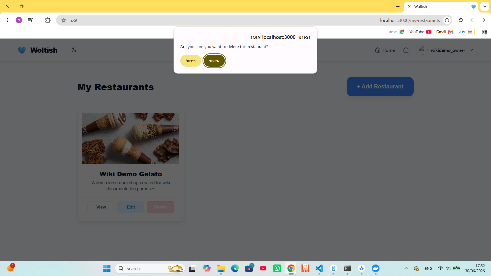

---

## Mobile Client

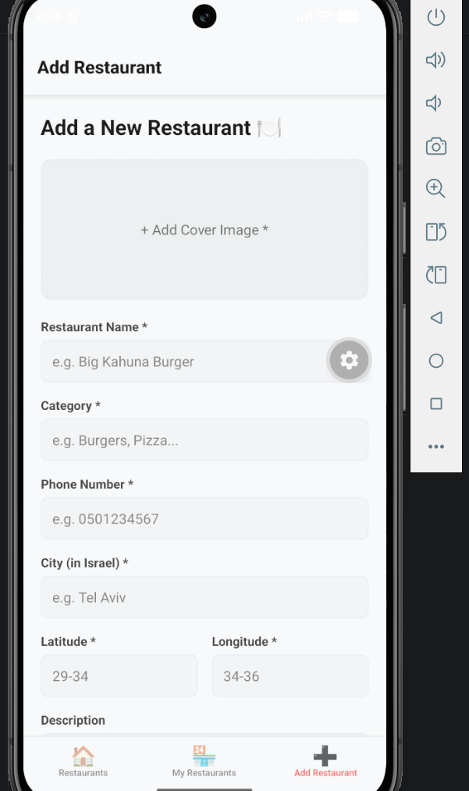

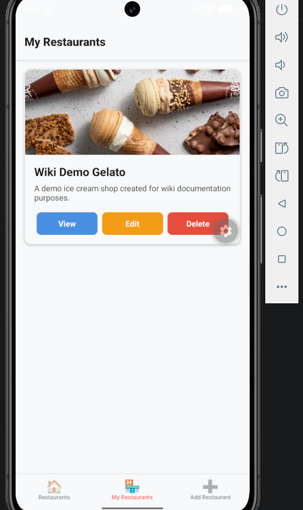

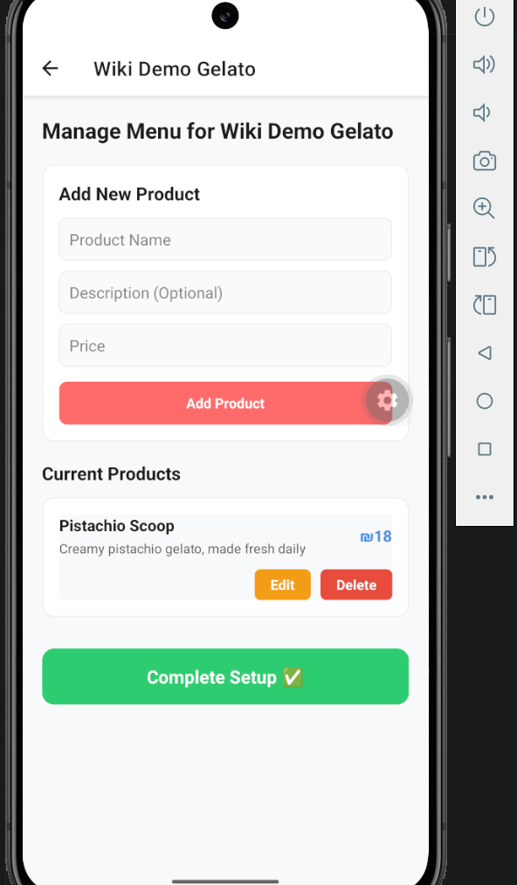

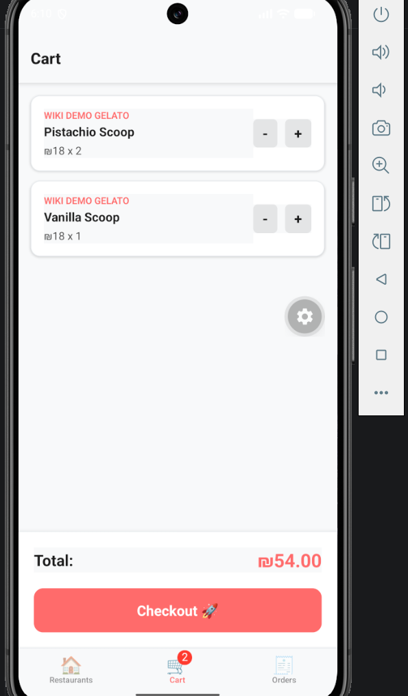

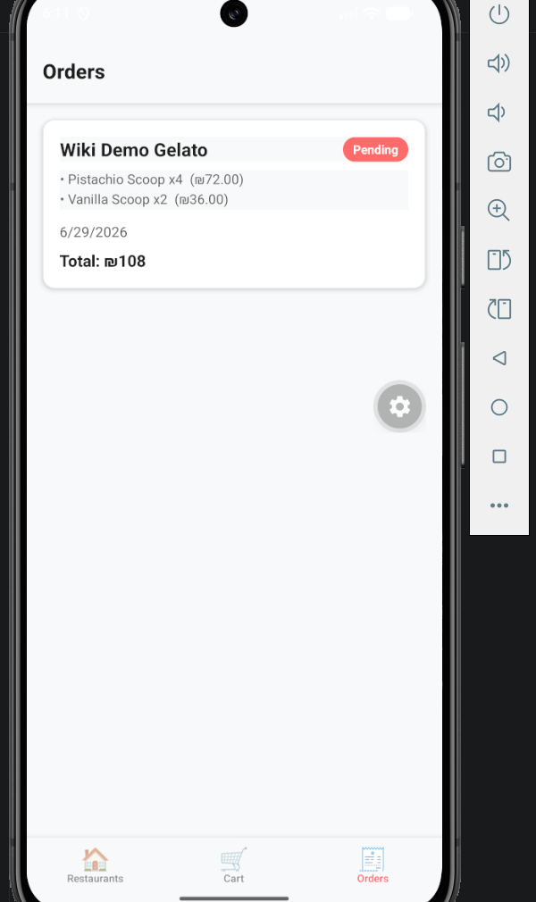

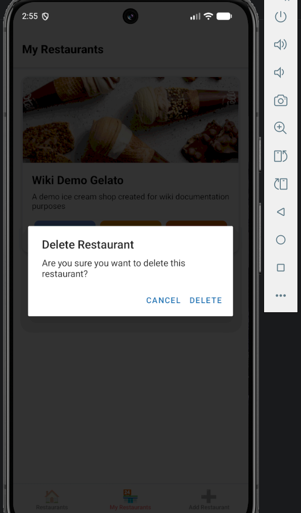